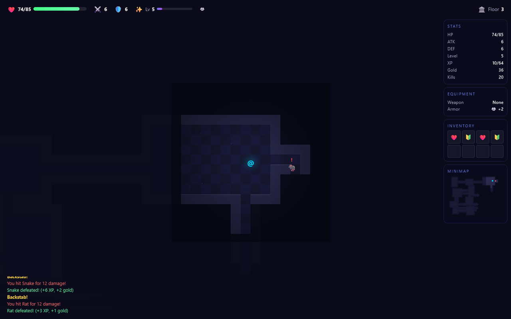
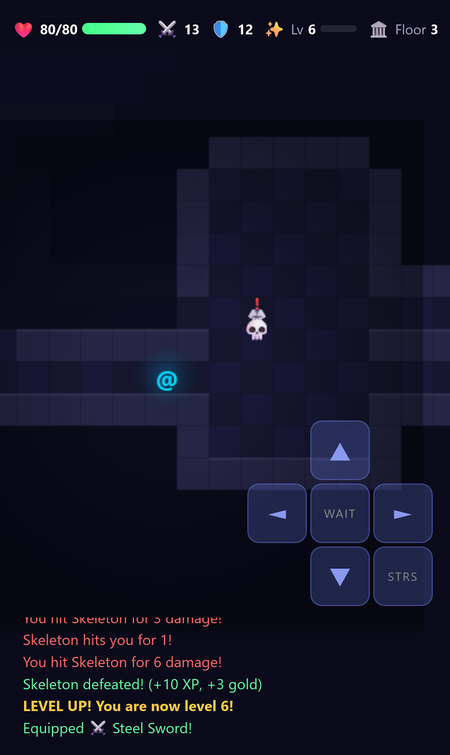
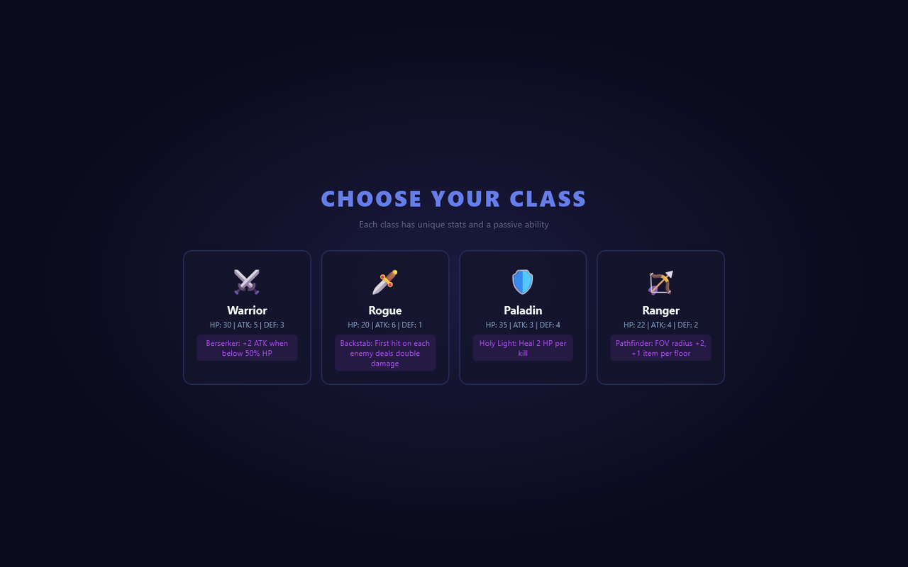

# Abyssal Depths
A turn-based roguelike dungeon crawler: pick a class, fight your way down ten randomly generated floors, and slay the Abyssal Dragon at the bottom.

**[▶ Open the live app](https://timothyhadfield.github.io/dungeon-crawler/)** · works on phone and laptop

  
  &nbsp;
  

  

## Features
- **Four classes**: Warrior, Rogue, Paladin and Ranger, each with its own stats and a passive ability (Berserker, Backstab, Holy Light, Pathfinder).
- **New dungeon every run**: rooms and corridors are generated fresh on each of 10 floors, with fog of war and a live minimap.
- **Bump-to-attack combat**: seven enemy types that get tougher the deeper you go, and a dragon boss on floor 10.
- **Loot and level-ups**: potions, weapons, armor and scrolls; better gear auto-equips, and each level-up lets you choose a stat boost.
- **Hazards and shrines**: hidden spike traps, water pools that slow enemies, and shrines to find.
- **Quality of life**: auto-explore (Tab), sound effects with a mute toggle, high scores and achievements saved in your browser.
- **Phone controls**: an on-screen D-pad with Wait and Stairs buttons appears on touch screens.

## Built with
One HTML file: plain JavaScript, Canvas and the Web Audio API. No build step, no server.
